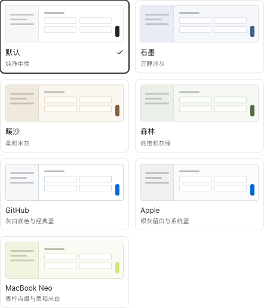
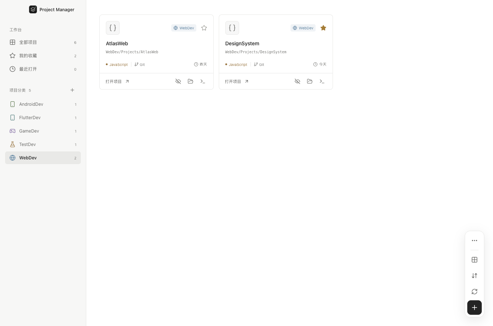
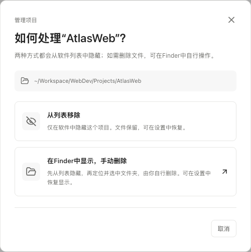

<p align="center">
  
</p>

<h1 align="center">BK Project Manager</h1>

<p align="center">
  <strong>Your projects. One workspace.</strong><br />
  <sub>A quieter place to find your projects and get back to work.</sub>
</p>

<p align="center">
  <a href="LICENSE"></a>
  <a href="https://github.com/binbinku/BKProjectManager/releases/latest"></a>
  
  
  
</p>

<p align="center">
  <a href="README.md">简体中文</a> · <strong>English</strong>
</p>

<p align="center">
  <a href="#project-manager">Project manager</a> ·
  <a href="#editor">Editor view</a> ·
  <a href="#downloads">Downloads</a> ·
  <a href="#quick-start">Run from source</a> ·
  <a href="#features">Features</a> ·
  <a href="#controls">Controls</a> ·
  <a href="#previews">More screenshots</a> ·
  <a href="#scanning">Discovery rules</a> ·
  <a href="#development">Development</a>
</p>

A local project manager for **macOS and Windows 11**. Bring projects into one workspace, organize them by category and find them through categories, favorites or recent activity. Open a project's editor view when you want to browse code and use its terminal.

<a id="project-manager"></a>

## 🗂️ Project manager · All your projects in view

Scan your workspace, browse categories and quickly find projects through categories, favorites and recently opened items. Switch between cards and a list, then open a project inside the app or in VS Code, Cursor or another editor.

<picture>
  <source media="(prefers-color-scheme: dark)" srcset="docs/assets/workspace-dark.png" />
  
</picture>

<p align="center">
  <a href="docs/assets/workspace-light.png">☀️ Light project manager</a> · <a href="docs/assets/workspace-dark.png">🌙 Dark project manager</a>
</p>

<a id="editor"></a>

## 💻 Editor view · Open a project and continue working

Open a project card to enter the three-panel workbench: browse files on the left, preview code in the center and run commands in the terminal on the right. Frosted navigation, Material file icons and thin dividers keep the content clear.

<picture>
  <source media="(prefers-color-scheme: dark)" srcset="docs/assets/workbench-dark.png" />
  
</picture>

<p align="center">
  <a href="docs/assets/workbench-light.png">☀️ Light editor view</a> · <a href="docs/assets/workbench-dark.png">🌙 Dark editor view</a><br />
  <sub>Both views use sample projects and follow your GitHub light or dark appearance. The app UI is currently in Chinese.</sub>
</p>

> **Versions:** the editor view is part of the v0.2.0 source preview. Published v0.1.1 installers provide project management. To try the complete workbench, [run from source](#quick-start). Code preview is read-only; editing and saving files are not supported.

<a id="features"></a>

## ✨ Features

<table>
  <tr>
    <td width="50%"><strong>🗂️ Automatic organization</strong><br />Top-level folders become categories. Projects are discovered inside Projects containers or directly within a category.</td>
    <td width="50%"><strong>🎛️ Lightweight controls</strong><br />A unified project canvas with vertical floating controls for view, sort, rescan and creation.</td>
  </tr>
  <tr>
    <td><strong>🎨 Category identity</strong><br />Stable colors and icons for every category, with custom appearances saved separately for each workspace.</td>
    <td><strong>➕ Start something new</strong><br />Create categories and empty projects directly in the app. New items appear automatically.</td>
  </tr>
  <tr>
    <td><strong>⭐ Keep favorites close</strong><br />Bookmark your regular projects and return to previous work through Recently opened.</td>
    <td><strong>🚀 Get back to work</strong><br />Open Finder / File Explorer, a project terminal, VS Code, Cursor, or a custom editor.</td>
  </tr>
  <tr>
    <td><strong>📄 Focused browsing</strong><br />One read-only file at a time, with line numbers and VS Code default syntax colors. No file tabs.</td>
    <td><strong>⌨️ Built-in terminal</strong><br />Run commands in the project directory, with ANSI true color, scrollback and process interruption.</td>
  </tr>
  <tr>
    <td><strong>🌗 Choose your appearance</strong><br />Seven palettes: Default, Graphite, Warm Sand, Forest, GitHub, Apple and MacBook Neo, each supporting light, dark and system appearance with identical layouts.</td>
    <td><strong>🔒 Local by design</strong><br />Preferences stay on your computer. Scanning does not move or delete projects, and no cloud account is required.</td>
  </tr>
</table>

## 🧩 Using the workbench (source preview)

The v0.2.0 source opens projects in a three-panel workbench. Published v0.1.1 installers do not include this feature yet.

- **Left:** a fixed header contains Back, the project name and the actual icon of your default external app. The tree starts below it and scrolls behind its translucent frosted surface. Bundled Material Icon Theme icons support folder expansion and light/dark appearance.
- **Center:** a viewer extending from the top to the bottom of the window, showing one read-only file at a time, with line numbers and VS Code Light+ / Dark+ syntax highlighting. No file tabs or editing controls. Common images can also be previewed.
- **Right:** an interactive terminal extending from the top to the bottom of the window, starting in the project directory, with scrolling, Ctrl+C, clear and restart. Clear and restart are available in the native Terminal menu. macOS uses your login shell; Windows 11 uses PowerShell.
- **Compact layout:** the viewer and terminal extend to the top and bottom edges. Visible 1px dividers retain a wider drag area for resizing. Returning to the project list closes the project's terminal.
- **Scrolling and appearance:** scrollbars are hidden; mouse-wheel, trackpad and horizontal scrolling remain available. Light, dark and system appearance are available through Settings in the native menu.

Preview supports UTF-8 and UTF-16 text and common images up to 2 MiB. Files over 200,000 characters use plain-text preview. Binary or unsupported files show an explanation. Project browsing stays within the selected project; symbolic links are not expandable in the tree.

<a id="controls"></a>

## 🎛️ Controls and shortcuts

Settings, file refresh and terminal actions live in the native menu bar. Menu labels below match the app's current Chinese interface.

| Action                       | Menu or entry point                                      | macOS    | Windows 11 |
| ---------------------------- | -------------------------------------------------------- | -------- | ---------- |
| Open Settings                | macOS: BK Project Manager → 设置…; Windows: 文件 → 设置… | `⌘,`     | `Ctrl+,`   |
| Refresh project files        | 查看 → 刷新文件目录                                      | `⌘R`     | `Ctrl+R`   |
| Clear terminal output        | 终端 → 清空终端                                          | —        | —          |
| Restart the project terminal | 终端 → 重新启动终端                                      | —        | —          |
| Change project view          | Bottom-right floating toolbar → 显示方式                 | —        | —          |
| Sort projects                | Bottom-right floating toolbar → 项目排序                 | —        | —          |
| Interrupt a terminal command | Focus the terminal                                       | `Ctrl+C` | `Ctrl+C`   |

Click the app icon in the header to open the project using your default external opener; hover to see its name. After running `exit`, restart through the Terminal menu. **Returning to the project list or restarting the terminal ends its current process.**

<a id="downloads"></a>

## 📦 Downloads

**Published installers: v0.1.1.** These support discovery, search, favorites, external opening and themes, but do not include the v0.2.0 workbench shown above. Download from the [latest release](https://github.com/binbinku/BKProjectManager/releases/latest):

| Platform                         | Installer                                                                                                                 | ZIP archive                                                                                                                |
| -------------------------------- | ------------------------------------------------------------------------------------------------------------------------- | -------------------------------------------------------------------------------------------------------------------------- |
| macOS · Apple Silicon (M series) | [DMG](https://github.com/binbinku/BKProjectManager/releases/download/v0.1.1/BKProjectManager-0.1.1-mac-arm64.dmg)         | [ZIP](https://github.com/binbinku/BKProjectManager/releases/download/v0.1.1/BKProjectManager-0.1.1-mac-arm64.zip)          |
| macOS · Intel                    | [DMG](https://github.com/binbinku/BKProjectManager/releases/download/v0.1.1/BKProjectManager-0.1.1-mac-x64.dmg)           | [ZIP](https://github.com/binbinku/BKProjectManager/releases/download/v0.1.1/BKProjectManager-0.1.1-mac-x64.zip)            |
| Windows · x64                    | [EXE installer](https://github.com/binbinku/BKProjectManager/releases/download/v0.1.1/BKProjectManager-0.1.1-win-x64.exe) | [No-install ZIP](https://github.com/binbinku/BKProjectManager/releases/download/v0.1.1/BKProjectManager-0.1.1-win-x64.zip) |

On macOS, open the DMG and drag the app into Applications. On Windows, run the installer or extract the ZIP and launch the application. Choose a workspace on first launch.

> v0.1.1 does not have developer code signing or macOS notarization, so your operating system may display trust prompts. Each release includes `SHA256SUMS.txt` for download verification.

<a id="quick-start"></a>

## 🚀 Run from source

Requires **Node.js 22.12+** and **npm**. Node.js 24 LTS is recommended.

```sh
git clone https://github.com/binbinku/BKProjectManager.git
cd BKProjectManager
npm ci
npm run dev
```

1. On first launch, choose a workspace such as `~/Workspace` or `D:\Workspace`.
2. The app reads your directory structure and builds the project categories and list.
3. Click **打开项目** (Open project) to enter the workbench: expand folders on the left, preview files in the center and type commands in the terminal.
4. Open **设置…** (Settings) from the native menu to choose appearance and your default editor. The app icon in the header opens the project externally.

Click **Rescan** after adding or moving projects. You can switch workspaces through **Settings…** in the native menu (macOS: app menu, `⌘,`; Windows: File menu, `Ctrl+,`).

The sidebar starts with a single row containing the app icon and name, aligned with the native traffic lights on macOS. Workspace management is available through Settings in the native menu.

### Built-in color themes (source preview)

Open **Settings… → 配色主题** (Color theme) from the native menu, then choose a preview card. The choice saves locally. Palette and appearance mode are independent:

| Theme            | Style                                                  |
| ---------------- | ------------------------------------------------------ |
| 默认 · Default   | The existing clean neutral palette                     |
| 石墨 · Graphite  | Cool gray with restrained blue accents                 |
| 暖沙 · Warm Sand | Soft beige gray and muted warm brown                   |
| 森林 · Forest    | Quiet, low-saturation gray green                       |
| GitHub           | White and deep gray with classic blue accents          |
| Apple            | Silver gray with crisp system blue                     |
| MacBook Neo      | Soft off-white and charcoal with citrus yellow accents |

The GitHub palette draws from [Primer](https://primer.style/product/getting-started/foundations/color-usage/); MacBook Neo takes inspiration from [Citrus](https://www.apple.com/macbook-neo/), softened for comfortable everyday use.

Themes change colors only. Sizes, spacing, panel proportions and floating controls stay in place. The code viewer, line-number gutter and terminal share the palette background, while the explorer uses a related sidebar tone. Syntax highlighting retains VS Code Light+ / Dark+ colors while ANSI and true-color program output remain supported.

<picture>
  <source media="(prefers-color-scheme: dark)" srcset="docs/assets/themes-dark.png" />
  
</picture>

### Creating categories and projects (source preview)

- Click **＋** beside the sidebar's category heading, enter a name and choose a color and icon. The app creates `Workspace/CategoryName/Projects/`.
- Select a category and choose **… → 修改分类外观** (Category appearance) in the bottom-right floating controls. The sidebar and project cards update together.
- Click **新建项目** (New project), choose a category and enter a name to create an empty folder. It goes into the existing `Projects` container, or directly under the category when no container exists. The list refreshes automatically.
- Categories that are recognized project roots cannot host new child projects. Duplicate names, invalid paths and reserved names produce an error without overwriting existing content.

Category appearances stay in local preferences; no configuration files are added to existing projects. Published v0.1.1 installers do not include these additions yet.

All projects, Favorites, Recently opened and category pages share a project canvas without a top bar, statistics, search or extra heading rows. A vertical floating toolbar in the bottom-right corner provides **view, sort, rescan and new project** controls for both card and list views. Category pages also have an **…** menu for category appearance and removal. Recently opened defaults to the latest opening time first, with name and directory modification time available in its sort menu.

### Removing, restoring and manual deletion (source preview)

Click the hide icon on a project card, or choose **… → 移除分类** (Remove category) in the selected category's bottom-right toolbar, to open a dialog:

- **从列表移除** (Remove from list): hide the item in the current workspace. Removing a category also hides its projects. This persists across rescans and restarts while keeping all files intact.
- **在 Finder / 资源管理器中显示，手动删除** (Show in Finder / File Explorer for manual deletion): immediately hide the entry, then locate and select the folder so you can delete it yourself. The app does not delete files. Even if you keep the folder, the entry stays hidden across rescans and restarts and can be restored in Settings.
- **Restore:** open **Settings… → 已移除的内容** (Removed items) from the native menu to restore individual entries or everything. Projects removed individually stay hidden when their category is restored, until you restore them too. Favorites and recent activity are retained.

Restoring clears the hidden entry only; folders deleted or moved outside the app are not recreated.

> **Validation scope:** the current workbench and local preview are tested on macOS Apple Silicon. Existing Intel installers have been tested through Rosetta 2. Windows x64 installers are cross-built on macOS and still await Windows 11 runtime testing. Dependency installation needs internet access for npm packages and Electron; bundled icons load offline at runtime.

<a id="previews"></a>

## 🖼️ More screenshots

The project management and editor pages are shown in full above. Below are the list view, settings, removal dialog and first-launch screens.

<details>
<summary><strong>List view · Browse more compactly</strong></summary>

<br />


</details>

<details>
<summary><strong>Category view · Projects first, floating controls</strong></summary>

<br />
<picture>
  <source media="(prefers-color-scheme: dark)" srcset="docs/assets/category-dark.png" />
  
</picture>

</details>

<details>
<summary><strong>Appearance settings · Immediate preview, saved automatically</strong></summary>

<p align="center">
  <br />
  
</p>

</details>

<details>
<summary><strong>First launch · Start with a workspace</strong></summary>

<br />


</details>

<details>
<summary><strong>Removal dialog · Hide or reveal for manual deletion</strong></summary>

<p align="center">
  <br />
  <picture>
    <source media="(prefers-color-scheme: dark)" srcset="docs/assets/remove-dark.png" />
    
  </picture>
</p>

</details>

<a id="scanning"></a>

## 🗂️ Your folders, organized

Keep your existing files where they are. A structure like this works directly as a workspace:

```text
Workspace/
├── WebDev/                   → Category: WebDev
│   └── Projects/             → Flattened in the project navigation
│       ├── AtlasWeb/         → Project
│       └── DesignSystem/     → Project
├── GameDev/                  → Category: GameDev
│   ├── Engine/               → Not scanned when Projects exists
│   └── Projects/
│       └── OrbitGame/        → Project
└── TestDev/                  → Category: TestDev
    └── DevTools/             → Direct child used when Projects is absent
```

**Discovery order:** check whether the top-level folder is itself a project → look for a `Projects` container → scan its direct children. If `Projects` is itself a recognized project, the entire directory is kept as one project.

For example, if `AndroidDev/Projects` contains `settings.gradle.kts`, it is treated as one Android project. Its `app`, `build`, and `gradle` folders will not become separate projects.

<details>
<summary><strong>Project detection and filtering</strong></summary>

| Type              | Detection markers                                |
| ----------------- | ------------------------------------------------ |
| Unity / Tuanjie   | `Assets` + `ProjectSettings`; displayed as Unity |
| Unreal Engine     | `*.uproject`                                     |
| Android           | `settings.gradle` / `settings.gradle.kts`        |
| Flutter           | `pubspec.yaml`                                   |
| JavaScript        | `package.json`                                   |
| Rust / Go         | `Cargo.toml` / `go.mod`                          |
| Python            | `pyproject.toml` / `requirements.txt`            |
| .NET              | `*.sln` / `*.slnx` / `*.csproj`                  |
| Java              | `pom.xml`                                        |
| Other directories | Kept as folders                                  |

- The `Projects` container name is matched case-insensitively. Discovery does not recurse indefinitely.
- Files, hidden directories, symlinks, and generated folders such as `node_modules`, `build`, `dist`, `target`, and `vendor` are skipped.
- A Git label is shown when a `.git` marker is present.
- Modification time means the project root directory's filesystem timestamp, not the newest file anywhere in the project.

</details>

<a id="development"></a>

## 🛠️ Development and builds

**Electron · React · TypeScript · Vite**

| Command                    | Purpose                                                             |
| -------------------------- | ------------------------------------------------------------------- |
| `npm run dev`              | Start the development environment                                   |
| `npm run build`            | Generate file icons, check TypeScript and build the frontend        |
| `npm start`                | Launch the built desktop application                                |
| `npm test`                 | Test discovery, settings, project files and sessions                |
| `npm run test:workbench`   | Test project browsing, file preview, real terminal and cleanup      |
| `npm run test:smoke`       | Verify key interactions in a real Electron window                   |
| `npm run test:management`  | Test category appearance, new folders and restart persistence       |
| `npm run test:removal`     | Test removal dialogs, reveal, restore and filesystem integrity      |
| `npm run test:category`    | Test the minimal category page, floating tools, sort and views      |
| `npm run test:palettes`    | Test palettes, light/dark appearance, stable layout and persistence |
| `npm run format:check`     | Check source formatting                                             |
| `npm run docs:screenshots` | Build the app and regenerate screenshots with sample data           |

Desktop interaction tests and screenshot generation require a desktop session. They use temporary workspaces and isolated settings, leaving your preferences intact. Documentation screenshots never read your project directories.

### Local packaging

```sh
npm run pack       # Application directory for the current platform
npm run dist:mac   # macOS: DMG + ZIP
npm run dist:win   # Windows: NSIS installer + ZIP
```

Output is written to `release/`. All packages are built locally, without GitHub Actions. Build on the target operating system where possible. The application, Dock and installers use the project logo. Run `npm run icons:generate` on macOS or Windows to regenerate PNG, macOS ICNS and Windows ICO assets from `docs/assets/logo.svg`. Distribution packages do not yet have code signing or macOS notarization. Automatic updates are not implemented yet.

### File tree icons

`npm run dev` and `npm run build` generate Material Icon Theme SVGs and associations from the pinned official npm package. No VS Code extension is required. Generated assets are excluded from Git and bundled with their license in production builds. See [third-party notices](THIRD_PARTY_NOTICES.md) for attribution.

### Project structure

```text
electron/     # Native menus, restricted IPC, discovery, files and PTY
src/          # Project list, file tree, code viewer and themes
scripts/      # Development launcher, icons, desktop tests and screenshots
tests/        # Discovery, persistence, project file and session tests
docs/assets/  # Documentation SVG and demo screenshots
licenses/     # Third-party licenses distributed with the app
```

Settings are stored in Electron's `userData/settings.json`. Set `BKPM_USER_DATA` to use an isolated configuration directory. The renderer disables Node integration, enables context isolation and sandboxing, and uses project IDs to invoke restricted IPC operations.

<a id="contributing"></a>

## 🤝 Contributing

[Issues](https://github.com/binbinku/BKProjectManager/issues) and [pull requests](https://github.com/binbinku/BKProjectManager/pulls) are welcome.

- **Report a bug:** include your operating system, reproduction steps, and a directory example with private information removed.
- **Propose a change:** explain its purpose and run `npm test`, `npm run build`, and `npm run format:check`. Include screenshots for UI changes.
- **Improve the docs:** keep the Chinese and English READMEs in sync.

<a id="license"></a>

## 📄 License

Released under the [MIT License](LICENSE). You may use, modify, and redistribute this project while retaining the copyright and license notice.

File tree icons are from [Material Icon Theme](https://github.com/material-extensions/vscode-material-icon-theme) (MIT). See [third-party notices](THIRD_PARTY_NOTICES.md).

<p align="center">
  <sub>Copyright © 2026 <a href="https://github.com/binbinku">binbinku</a></sub>
</p>
