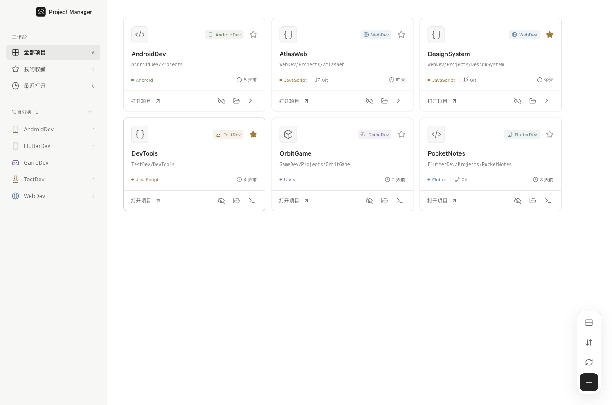
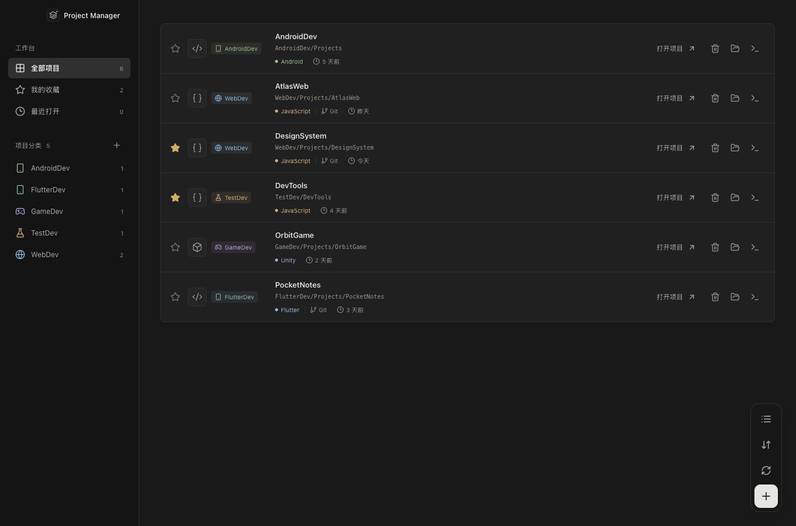
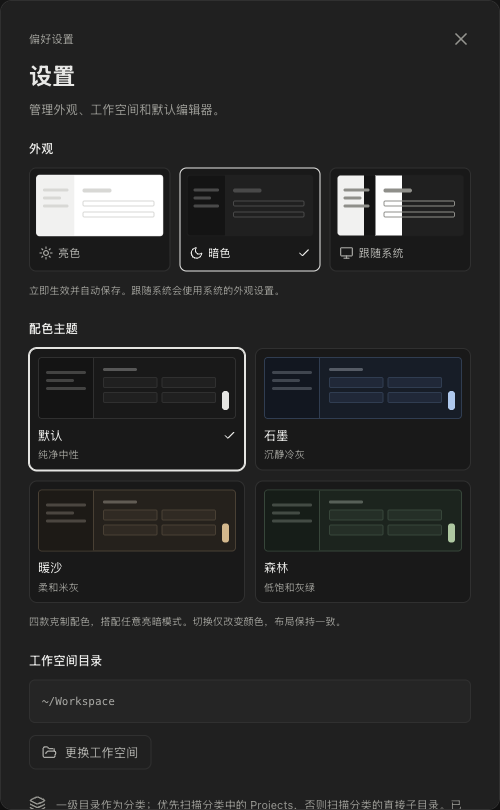
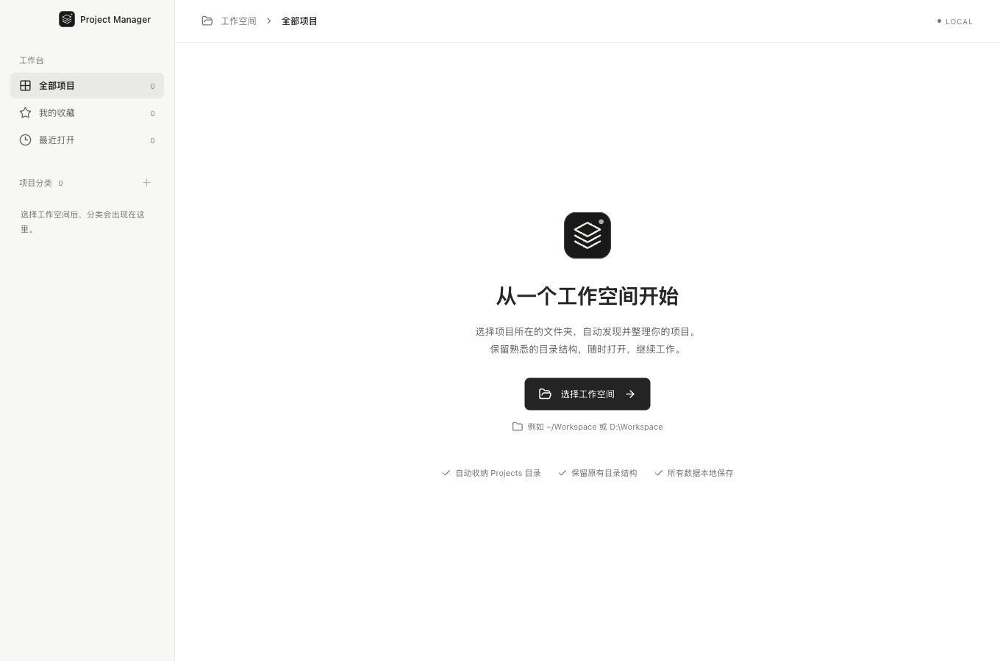

<p align="center">
  
</p>

<h1 align="center">BK Project Manager</h1>

<p align="center">
  <strong>项目各归其位，开始更轻松。</strong><br />
  <sub>Your projects. One workspace.</sub>
</p>

<p align="center">
  <a href="LICENSE"></a>
  <a href="https://github.com/binbinku/BKProjectManager/releases/latest"></a>
  
  
  
</p>

<p align="center">
  <strong>简体中文</strong> · <a href="README.en.md">English</a>
</p>

<p align="center">
  <a href="#downloads">下载安装</a> ·
  <a href="#quick-start">源码运行</a> ·
  <a href="#features">功能一览</a> ·
  <a href="#previews">界面预览</a> ·
  <a href="#scanning">扫描规则</a> ·
  <a href="#development">开发与构建</a>
</p>

<picture>
  <source media="(prefers-color-scheme: dark)" srcset="docs/assets/workspace-dark.png" />
  <source media="(prefers-color-scheme: light)" srcset="docs/assets/workspace-light.png" />
  
</picture>

<p align="center">
  <sub>跟随 GitHub 外观展示亮暗主题 · 截图使用示例项目</sub><br />
  <a href="docs/assets/workspace-light.png">☀️ 亮色预览</a> · <a href="docs/assets/workspace-dark.png">🌙 暗色预览</a>
</p>

为 **macOS 与 Windows 11** 设计的本地项目工作台。选择一个工作空间，自动整理目录中的项目，在同一个入口搜索、收藏，并打开编辑器、终端或文件管理器。

界面采用受 Codex 启发的中性灰阶、细边框和简洁排版。你的目录结构照旧，工作入口更集中。

<a id="features"></a>

## ✨ 功能一览

<table>
  <tr>
    <td width="50%"><strong>🗂️ 自动整理</strong><br />一级目录作为分类，自动收纳 Projects 下的项目；也支持直接放在分类里的项目。</td>
    <td width="50%"><strong>🔎 快速定位</strong><br />按名称、分类、技术类型或相对路径搜索，使用 ⌘ / Ctrl + K 聚焦搜索框。</td>
  </tr>
  <tr>
    <td><strong>⭐ 随手收藏</strong><br />收藏常用项目，通过「最近打开」快速回到手头的工作。</td>
    <td><strong>🚀 一键继续</strong><br />打开 Finder / 资源管理器、项目终端、VS Code、Cursor，或自选编辑器。</td>
  </tr>
  <tr>
    <td><strong>🌗 亮暗随心</strong><br />亮色、暗色、跟随系统三种外观，搭配卡片与列表视图。</td>
    <td><strong>🔒 数据留在本机</strong><br />设置本地保存，扫描不移动或删除项目文件，无需云端账户。</td>
  </tr>
</table>

<a id="downloads"></a>

## 📦 下载安装

从 [最新 Release](https://github.com/binbinku/BKProjectManager/releases/latest) 下载对应平台的版本：

| 平台                            | 安装包                                                                                                                 | ZIP 归档                                                                                                               |
| ------------------------------- | ---------------------------------------------------------------------------------------------------------------------- | ---------------------------------------------------------------------------------------------------------------------- |
| macOS · Apple Silicon（M 系列） | [DMG](https://github.com/binbinku/BKProjectManager/releases/download/v0.1.0/BKProjectManager-0.1.0-mac-arm64.dmg)      | [ZIP](https://github.com/binbinku/BKProjectManager/releases/download/v0.1.0/BKProjectManager-0.1.0-mac-arm64.zip)      |
| macOS · Intel                   | [DMG](https://github.com/binbinku/BKProjectManager/releases/download/v0.1.0/BKProjectManager-0.1.0-mac-x64.dmg)        | [ZIP](https://github.com/binbinku/BKProjectManager/releases/download/v0.1.0/BKProjectManager-0.1.0-mac-x64.zip)        |
| Windows · x64                   | [EXE 安装包](https://github.com/binbinku/BKProjectManager/releases/download/v0.1.0/BKProjectManager-0.1.0-win-x64.exe) | [免安装 ZIP](https://github.com/binbinku/BKProjectManager/releases/download/v0.1.0/BKProjectManager-0.1.0-win-x64.zip) |

macOS 打开 DMG 后将应用拖入 Applications；Windows 运行 EXE 安装，或解压 ZIP 后启动应用。首次启动时选择工作空间即可。

> v0.1.0 未配置开发者代码签名和 macOS 公证，系统可能显示信任提示。Release 附带 `SHA256SUMS.txt`，可用于核对下载文件。

<a id="quick-start"></a>

## 🚀 从源码启动

需要 **Node.js 22.12+** 和 **npm**，建议使用 Node.js 24 LTS。

```sh
git clone https://github.com/binbinku/BKProjectManager.git
cd BKProjectManager
npm ci
npm run dev
```

1. 首次启动，选择工作空间，例如 `~/Workspace` 或 `D:\Workspace`。
2. 应用读取目录结构，自动生成分类和项目列表。
3. 搜索项目，点击星标收藏，或在设置中选择默认编辑器。

新增或移动项目后，点击 **重新扫描**。更换工作空间可在 **设置** 中完成。

> **验证范围**：本地构建 macOS Apple Silicon / Intel 与 Windows x64 安装包；macOS 应用在本机运行测试（Intel 版通过 Rosetta 2），Windows 版为交叉构建，尚待 Windows 11 实机验证。源码首次启动可能需要联网下载 Electron 运行时。

<a id="previews"></a>

## 🖼️ 界面预览

首页截图会随 GitHub 的亮暗外观自动切换，也可以点击上方链接查看另一种主题。

<details>
<summary><strong>列表视图 · 更紧凑地浏览项目</strong></summary>

<br />


</details>

<details>
<summary><strong>外观设置 · 即时预览，自动保存</strong></summary>

<p align="center">
  <br />
  
</p>

</details>

<details>
<summary><strong>首次启动 · 从一个工作空间开始</strong></summary>

<br />


</details>

<a id="scanning"></a>

## 🗂️ 熟悉的目录，清晰的分类

无需重新组织磁盘文件。下面这样的目录，可以直接作为工作空间：

```text
Workspace/
├── WebDev/                   → 分类：WebDev
│   └── Projects/             → 展示时收纳这一层
│       ├── AtlasWeb/         → 项目
│       └── DesignSystem/     → 项目
├── GameDev/                  → 分类：GameDev
│   ├── Engine/               → 有 Projects 时，不扫描这个同级目录
│   └── Projects/
│       └── OrbitGame/        → 项目
└── TestDev/                  → 分类：TestDev
    └── DevTools/             → 没有 Projects 时，直接识别子目录
```

**扫描顺序**：识别一级目录自身是否为工程 → 查找分类下的 `Projects` → 扫描容器的直接子目录。`Projects` 自身已是工程时，也会作为一个完整项目收纳。

例如 `AndroidDev/Projects` 中含有 `settings.gradle.kts`，会将整个目录识别为 Android 项目，避免把 `app`、`build`、`gradle` 分别列为项目。

<details>
<summary><strong>项目类型识别与过滤规则</strong></summary>

| 类型            | 识别标记                                   |
| --------------- | ------------------------------------------ |
| Unity / Tuanjie | `Assets` + `ProjectSettings`，显示为 Unity |
| Unreal Engine   | `*.uproject`                               |
| Android         | `settings.gradle` / `settings.gradle.kts`  |
| Flutter         | `pubspec.yaml`                             |
| JavaScript      | `package.json`                             |
| Rust / Go       | `Cargo.toml` / `go.mod`                    |
| Python          | `pyproject.toml` / `requirements.txt`      |
| .NET            | `*.sln` / `*.slnx` / `*.csproj`            |
| Java            | `pom.xml`                                  |
| 其他目录        | 保留为「文件夹」                           |

- `Projects` 名称匹配不区分大小写；不会无限递归扫描。
- 默认跳过文件、隐藏目录、符号链接，以及 `node_modules`、`build`、`dist`、`target`、`vendor` 等生成目录。
- 检测到 `.git` 标记时显示 Git 标签。
- 「修改时间」指项目根目录的文件系统时间，不代表工程内所有文件的最新修改时间。

</details>

<a id="development"></a>

## 🛠️ 开发与构建

**Electron · React · TypeScript · Vite**

| 命令                       | 用途                               |
| -------------------------- | ---------------------------------- |
| `npm run dev`              | 启动开发环境                       |
| `npm run build`            | TypeScript 检查并构建前端          |
| `npm start`                | 运行已构建的桌面应用               |
| `npm test`                 | 验证扫描规则与配置持久化           |
| `npm run test:smoke`       | 在真实 Electron 窗口中验证主要交互 |
| `npm run format:check`     | 检查代码格式                       |
| `npm run docs:screenshots` | 构建应用并使用示例数据更新文档截图 |

桌面交互测试和截图生成需要可用的桌面会话。它们使用临时工作空间和独立配置，不覆盖你的使用偏好；文档截图不会读取你的项目目录。

### 本地打包

```sh
npm run pack       # 当前平台的应用目录
npm run dist:mac   # macOS：DMG + ZIP
npm run dist:win   # Windows：NSIS 安装包
```

产物位于 `release/`。建议在目标系统上构建；当前打包默认使用 Electron 图标，正式分发时还需配置代码签名与 macOS 公证。暂未接入自动更新。

### 代码结构

```text
electron/     # 窗口、受限 IPC、目录扫描与本地配置
src/          # React 界面与主题
scripts/      # 开发启动、桌面测试与截图生成
tests/        # 扫描与持久化测试
docs/assets/  # 文档 SVG 与演示截图
```

设置保存在 Electron 的 `userData/settings.json`。可使用 `BKPM_USER_DATA` 指定独立配置目录；渲染进程关闭 Node 集成，启用 context isolation 与 sandbox，系统操作通过项目 ID 调用受限 IPC。

<a id="contributing"></a>

## 🤝 一起完善

欢迎提交 [Issue](https://github.com/binbinku/BKProjectManager/issues) 或 [Pull Request](https://github.com/binbinku/BKProjectManager/pulls)。

- **反馈问题**：请附上操作系统、复现步骤，以及脱敏后的目录结构。
- **提交改进**：说明改动目的，运行 `npm test`、`npm run build` 和 `npm run format:check`；涉及界面时补充截图。
- **改进文档**：请同步更新中文版与英文版，保持说明一致。

<a id="license"></a>

## 📄 开源许可证

采用 [MIT License](LICENSE) 开源。你可以使用、修改和分发本项目，请保留版权与许可声明。

<p align="center">
  <sub>Copyright © 2026 <a href="https://github.com/binbinku">binbinku</a></sub>
</p>
