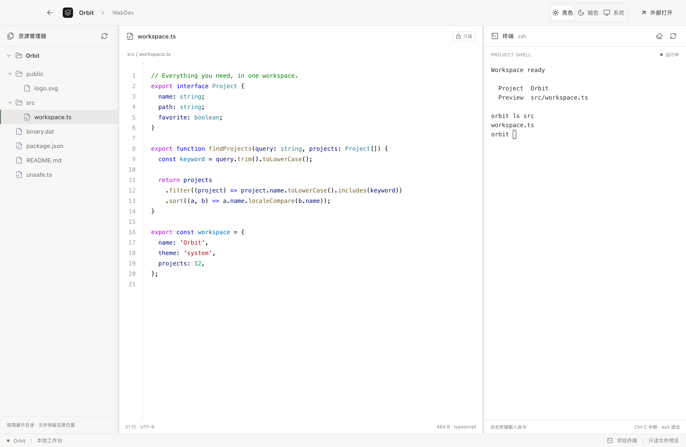

<p align="center">
  
</p>

<h1 align="center">BK Project Manager</h1>

<p align="center">
  <strong>项目各归其位，开始更轻松。</strong><br />
  <sub>Your projects. One workspace.</sub>
</p>

<p align="center">
  <a href="LICENSE"></a>
  <a href="https://github.com/binbinku/BKProjectManager/releases/latest"></a>
  
  
  
</p>

<p align="center">
  <strong>简体中文</strong> · <a href="README.en.md">English</a>
</p>

<p align="center">
  <a href="#downloads">下载安装</a> ·
  <a href="#quick-start">源码运行</a> ·
  <a href="#features">功能一览</a> ·
  <a href="#controls">操作与快捷键</a> ·
  <a href="#previews">界面预览</a> ·
  <a href="#scanning">扫描规则</a> ·
  <a href="#development">开发与构建</a>
</p>

> **当前源码：v0.2.0 工作台预览。** 下图展示最新源码界面；已发布的 v0.1.1 安装包仍为项目管理版本。体验文件树、代码预览和内置终端，请[从源码启动](#quick-start)。

<picture>
  <source media="(prefers-color-scheme: dark)" srcset="docs/assets/workbench-dark.png" />
  
</picture>

<p align="center">
  <sub>项目目录 · 只读代码 · 交互终端 · 截图使用示例项目</sub><br />
  <a href="docs/assets/workbench-light.png">☀️ 亮色工作台</a> · <a href="docs/assets/workbench-dark.png">🌙 暗色工作台</a>
</p>

为 **macOS 与 Windows 11** 设计的本地项目工作台。选择一个工作空间，自动发现和分类项目；打开项目后，在同一窗口浏览文件、只读查看代码并使用终端，也可以一键交给熟悉的编辑器。

界面采用受 Codex 启发的中性灰阶、细边框和简洁排版。你的目录结构照旧，工作入口更集中。

<a id="features"></a>

## ✨ 功能一览

<table>
  <tr>
    <td width="50%"><strong>🗂️ 自动整理</strong><br />一级目录作为分类，自动收纳 Projects 下的项目；也支持直接放在分类里的项目。</td>
    <td width="50%"><strong>🔎 快速定位</strong><br />按名称、分类、技术类型或相对路径搜索，使用 ⌘ / Ctrl + K 聚焦搜索框。</td>
  </tr>
  <tr>
    <td><strong>⭐ 随手收藏</strong><br />收藏常用项目，通过「最近打开」快速回到手头的工作。</td>
    <td><strong>🚀 一键继续</strong><br />打开 Finder / 资源管理器、项目终端、VS Code、Cursor，或自选编辑器。</td>
  </tr>
  <tr>
    <td><strong>📄 专注浏览</strong><br />单文件只读预览、行号与 VS Code 默认代码配色，不显示多文件标签。</td>
    <td><strong>⌨️ 内置终端</strong><br />进入项目目录即可运行命令，支持 ANSI 真彩色、滚动和进程中断。</td>
  </tr>
  <tr>
    <td><strong>🌗 亮暗随心</strong><br />亮色、暗色、跟随系统三种外观，搭配卡片与列表视图。</td>
    <td><strong>🔒 数据留在本机</strong><br />设置本地保存，扫描不移动或删除项目文件，无需云端账户。</td>
  </tr>
</table>

## 🧩 项目工作台（源码预览版）

v0.2.0 源码支持在软件内打开项目，进入三栏工作台。当前已发布的 v0.1.1 安装包尚未包含此功能。

- **左侧：** 固定顶部只保留返回、项目名和默认打开软件的真实图标；目录从下方开始，上滑时从半透明毛玻璃导航后面经过。文件和目录使用离线打包的 Material Icon Theme 图标，支持展开/收起及亮暗主题。
- **中间：** 代码区上下延伸至窗口边缘，一次只读预览一个文件，支持行号、VS Code Light+ / Dark+ 代码高亮和常见图片；不显示文件标签，不提供编辑保存。
- **右侧：** 上下延伸至窗口边缘的交互终端，启动在项目目录，支持滚动、Ctrl+C 中断、清空和重启；清空和重启操作位于系统菜单「终端」。macOS 使用登录 Shell，Windows 11 使用 PowerShell。
- **简洁布局：** 代码与终端上下直达窗口边缘，左右仅保留 1px 分界线，拖动范围保持宽于可见线条，方便调整面板。返回列表时会关闭当前项目终端。
- **滚动与外观：** 所有区域隐藏滚动条，保留滚轮、触控板和横向滚动；设置通过系统菜单访问，支持亮色、暗色和跟随系统。

预览支持 2 MiB 以内的 UTF-8、UTF-16 文本与常见图片；超过 20 万字符的文本使用纯文本预览。二进制或不支持的文件会显示说明。文件浏览限定在当前项目中，文件树不展开符号链接。

<a id="controls"></a>

## 🎛️ 操作与快捷键

设置、刷新目录和终端操作位于原生菜单栏，工作台内不再放置额外工具栏。

| 操作             | 菜单或入口                                               | macOS    | Windows 11 |
| ---------------- | -------------------------------------------------------- | -------- | ---------- |
| 打开设置         | macOS：BK Project Manager → 设置…；Windows：文件 → 设置… | `⌘,`     | `Ctrl+,`   |
| 刷新当前项目文件 | 查看 → 刷新文件目录                                      | `⌘R`     | `Ctrl+R`   |
| 清空终端显示     | 终端 → 清空终端                                          | —        | —          |
| 重启项目终端     | 终端 → 重新启动终端                                      | —        | —          |
| 搜索项目         | 项目列表中的搜索框                                       | `⌘K`     | `Ctrl+K`   |
| 中断终端命令     | 聚焦右侧终端                                             | `Ctrl+C` | `Ctrl+C`   |

点击顶部软件图标，按设置中的默认方式打开当前项目；悬停可查看软件名称。终端执行 `exit` 后，可通过菜单重新启动。**返回项目列表或重启终端会结束当前终端进程。**

<a id="downloads"></a>

## 📦 下载安装

**公开安装包：v0.1.1。** 支持工作空间扫描、搜索、收藏、外部打开和亮暗主题，尚未包含上方 v0.2.0 工作台。可从 [最新 Release](https://github.com/binbinku/BKProjectManager/releases/latest) 下载：

| 平台                            | 安装包                                                                                                                 | ZIP 归档                                                                                                               |
| ------------------------------- | ---------------------------------------------------------------------------------------------------------------------- | ---------------------------------------------------------------------------------------------------------------------- |
| macOS · Apple Silicon（M 系列） | [DMG](https://github.com/binbinku/BKProjectManager/releases/download/v0.1.1/BKProjectManager-0.1.1-mac-arm64.dmg)      | [ZIP](https://github.com/binbinku/BKProjectManager/releases/download/v0.1.1/BKProjectManager-0.1.1-mac-arm64.zip)      |
| macOS · Intel                   | [DMG](https://github.com/binbinku/BKProjectManager/releases/download/v0.1.1/BKProjectManager-0.1.1-mac-x64.dmg)        | [ZIP](https://github.com/binbinku/BKProjectManager/releases/download/v0.1.1/BKProjectManager-0.1.1-mac-x64.zip)        |
| Windows · x64                   | [EXE 安装包](https://github.com/binbinku/BKProjectManager/releases/download/v0.1.1/BKProjectManager-0.1.1-win-x64.exe) | [免安装 ZIP](https://github.com/binbinku/BKProjectManager/releases/download/v0.1.1/BKProjectManager-0.1.1-win-x64.zip) |

macOS 打开 DMG 后将应用拖入 Applications；Windows 运行 EXE 安装，或解压 ZIP 后启动应用。首次启动时选择工作空间即可。

> v0.1.1 未配置开发者代码签名和 macOS 公证，系统可能显示信任提示。Release 附带 `SHA256SUMS.txt`，可用于核对下载文件。

<a id="quick-start"></a>

## 🚀 从源码启动

需要 **Node.js 22.12+** 和 **npm**，建议使用 Node.js 24 LTS。

```sh
git clone https://github.com/binbinku/BKProjectManager.git
cd BKProjectManager
npm ci
npm run dev
```

1. 首次启动，选择工作空间，例如 `~/Workspace` 或 `D:\Workspace`。
2. 应用读取目录结构，自动生成分类和项目列表。
3. 点击 **打开项目** 进入工作台：左侧展开目录，中间查看文件，右侧直接输入终端命令。
4. 通过系统菜单打开 **设置…**，选择亮暗主题和默认编辑器；顶部软件图标用于外部打开项目。

新增或移动项目后，点击 **重新扫描**。更换工作空间可在系统菜单的 **设置…** 中完成（macOS：应用菜单，`⌘,`；Windows：文件菜单，`Ctrl+,`）。

> **验证范围**：当前工作台与本地预览包在 macOS Apple Silicon 上验证；既有 macOS Intel 安装包已通过 Rosetta 2 运行验证，Windows x64 安装包由 macOS 交叉构建，尚待 Windows 11 实机验证。安装依赖时需要联网下载 npm 包及 Electron 运行时，图标随应用打包，运行时不需要联网加载。

<a id="previews"></a>

## 🖼️ 界面预览

首页工作台截图会随 GitHub 的亮暗外观自动切换。下面展示项目列表、设置和首次启动页面，均使用示例项目生成。

<details>
<summary><strong>项目总览 · 按分类搜索与收藏</strong></summary>

<br />
<picture>
  <source media="(prefers-color-scheme: dark)" srcset="docs/assets/workspace-dark.png" />
  
</picture>

</details>

<details>
<summary><strong>列表视图 · 更紧凑地浏览项目</strong></summary>

<br />


</details>

<details>
<summary><strong>外观设置 · 即时预览，自动保存</strong></summary>

<p align="center">
  <br />
  
</p>

</details>

<details>
<summary><strong>首次启动 · 从一个工作空间开始</strong></summary>

<br />


</details>

<a id="scanning"></a>

## 🗂️ 熟悉的目录，清晰的分类

无需重新组织磁盘文件。下面这样的目录，可以直接作为工作空间：

```text
Workspace/
├── WebDev/                   → 分类：WebDev
│   └── Projects/             → 展示时收纳这一层
│       ├── AtlasWeb/         → 项目
│       └── DesignSystem/     → 项目
├── GameDev/                  → 分类：GameDev
│   ├── Engine/               → 有 Projects 时，不扫描这个同级目录
│   └── Projects/
│       └── OrbitGame/        → 项目
└── TestDev/                  → 分类：TestDev
    └── DevTools/             → 没有 Projects 时，直接识别子目录
```

**扫描顺序**：识别一级目录自身是否为工程 → 查找分类下的 `Projects` → 扫描容器的直接子目录。`Projects` 自身已是工程时，也会作为一个完整项目收纳。

例如 `AndroidDev/Projects` 中含有 `settings.gradle.kts`，会将整个目录识别为 Android 项目，避免把 `app`、`build`、`gradle` 分别列为项目。

<details>
<summary><strong>项目类型识别与过滤规则</strong></summary>

| 类型            | 识别标记                                   |
| --------------- | ------------------------------------------ |
| Unity / Tuanjie | `Assets` + `ProjectSettings`，显示为 Unity |
| Unreal Engine   | `*.uproject`                               |
| Android         | `settings.gradle` / `settings.gradle.kts`  |
| Flutter         | `pubspec.yaml`                             |
| JavaScript      | `package.json`                             |
| Rust / Go       | `Cargo.toml` / `go.mod`                    |
| Python          | `pyproject.toml` / `requirements.txt`      |
| .NET            | `*.sln` / `*.slnx` / `*.csproj`            |
| Java            | `pom.xml`                                  |
| 其他目录        | 保留为「文件夹」                           |

- `Projects` 名称匹配不区分大小写；不会无限递归扫描。
- 默认跳过文件、隐藏目录、符号链接，以及 `node_modules`、`build`、`dist`、`target`、`vendor` 等生成目录。
- 检测到 `.git` 标记时显示 Git 标签。
- 「修改时间」指项目根目录的文件系统时间，不代表工程内所有文件的最新修改时间。

</details>

<a id="development"></a>

## 🛠️ 开发与构建

**Electron · React · TypeScript · Vite**

| 命令                       | 用途                                     |
| -------------------------- | ---------------------------------------- |
| `npm run dev`              | 启动开发环境                             |
| `npm run build`            | 生成文件图标、检查 TypeScript 并构建前端 |
| `npm start`                | 运行已构建的桌面应用                     |
| `npm test`                 | 验证扫描、配置持久化、文件访问与会话     |
| `npm run test:workbench`   | 验证项目文件、预览、真实终端与进程清理   |
| `npm run test:smoke`       | 在真实 Electron 窗口中验证主要交互       |
| `npm run format:check`     | 检查代码格式                             |
| `npm run docs:screenshots` | 构建应用并使用示例数据更新文档截图       |

桌面交互测试和截图生成需要可用的桌面会话。它们使用临时工作空间和独立配置，不覆盖你的使用偏好；文档截图不会读取你的项目目录。

### 本地打包

```sh
npm run pack       # 当前平台的应用目录
npm run dist:mac   # macOS：DMG + ZIP
npm run dist:win   # Windows：NSIS 安装包 + ZIP
```

产物位于 `release/`。所有打包均在本地完成，不使用 GitHub Actions。建议在目标系统上构建；应用、Dock 与安装器使用项目自己的标志；图标由 `docs/assets/logo.svg` 生成，运行 `npm run icons:generate` 可重新生成 PNG、macOS ICNS 和 Windows ICO（支持在两种系统上执行）。分发包尚未配置代码签名与 macOS 公证。暂未接入自动更新。

### 文件树图标

`npm run dev` 和 `npm run build` 会从固定版本的官方 npm 包自动生成 Material Icon Theme 的 SVG 资源与匹配表，无需安装 VS Code 扩展。生成资源不提交到 Git；正式构建会将图标及许可一同打包。来源和许可见[第三方声明](THIRD_PARTY_NOTICES.md)。

### 代码结构

```text
electron/     # 原生菜单、受限 IPC、扫描、文件访问与 PTY 终端
src/          # 项目列表、文件树、代码预览与主题
scripts/      # 开发启动、图标生成、桌面测试与截图
tests/        # 扫描、持久化、文件访问与会话测试
docs/assets/  # 文档 SVG 与演示截图
licenses/     # 随应用分发的第三方许可
```

设置保存在 Electron 的 `userData/settings.json`。可使用 `BKPM_USER_DATA` 指定独立配置目录；渲染进程关闭 Node 集成，启用 context isolation 与 sandbox，系统操作通过项目 ID 调用受限 IPC。

<a id="contributing"></a>

## 🤝 一起完善

欢迎提交 [Issue](https://github.com/binbinku/BKProjectManager/issues) 或 [Pull Request](https://github.com/binbinku/BKProjectManager/pulls)。

- **反馈问题**：请附上操作系统、复现步骤，以及脱敏后的目录结构。
- **提交改进**：说明改动目的，运行 `npm test`、`npm run build` 和 `npm run format:check`；涉及界面时补充截图。
- **改进文档**：请同步更新中文版与英文版，保持说明一致。

<a id="license"></a>

## 📄 开源许可证

采用 [MIT License](LICENSE) 开源。你可以使用、修改和分发本项目，请保留版权与许可声明。

文件树图标来自 [Material Icon Theme](https://github.com/material-extensions/vscode-material-icon-theme)（MIT），详见[第三方声明](THIRD_PARTY_NOTICES.md)。

<p align="center">
  <sub>Copyright © 2026 <a href="https://github.com/binbinku">binbinku</a></sub>
</p>
